# Modelo relacional de conectividad fija

## Decisiones del modelo

La base separa los hechos provinciales históricos de los hechos territoriales
sin período. Cada tabla de hechos conserva la granularidad de su CSV; las
tecnologías, las categorías, la penetración y la velocidad no se unen en una
sola tabla ancha. Así se evitan duplicaciones al agregar fuentes con distinta
granularidad.

Las dimensiones de provincia, período, tecnología, categoría de velocidad y
localidad son compartidas. Se usan claves sustitutas para provincia, período,
tecnología, categoría y localidad; las restricciones `UNIQUE` y las PK
compuestas reflejan las claves naturales verificadas. Las filas originales se
guardan en tablas `stg_*`, con el CSV y número de fila como referencia de
trazabilidad. Sus campos numéricos tipados son conversiones explícitas de los
valores de texto de origen.

Las claves de provincia eliminan diferencias de acentos y mayúsculas; la
variante `Capital Federal` se asigna a `CABA`. Las claves de partido/localidad
normalizan Unicode a NFC, quitan espacios externos y aplican `casefold()`. La
dimensión conserva como texto visible la primera grafía de tecnologías y staging
mantiene todas las grafías fuente. La clave natural usa provincia más esas dos
claves; `LinkIndec` se conserva en staging, pero no es clave. Hay 191 códigos
reutilizados por fuente tras consolidar variantes de caja.

Las categorías de velocidad se guardan como etiquetas originales. No se
agregan unidades ni rangos. Los hechos locales no tienen FK a `dim_periodo`,
porque ninguno de sus dos archivos contiene año o trimestre.

## Diagrama entidad-relación

```mermaid
erDiagram
    DIM_PROVINCIA ||--o{ DIM_PROVINCIA_ALIAS : normaliza
    DIM_PROVINCIA ||--o{ DIM_LOCALIDAD : contiene
    DIM_PERIODO ||--o{ FACT_ACCESOS_PROVINCIA : fecha
    DIM_PROVINCIA ||--o{ FACT_ACCESOS_PROVINCIA : territorio
    DIM_PERIODO ||--o{ FACT_ACCESOS_TECNOLOGIA : fecha
    DIM_PROVINCIA ||--o{ FACT_ACCESOS_TECNOLOGIA : territorio
    DIM_TECNOLOGIA ||--o{ FACT_ACCESOS_TECNOLOGIA : clasifica
    DIM_PERIODO ||--o{ FACT_VELOCIDAD_PROVINCIA : fecha
    DIM_PROVINCIA ||--o{ FACT_VELOCIDAD_PROVINCIA : territorio
    DIM_PERIODO ||--o{ FACT_PENETRACION_PROVINCIA : fecha
    DIM_PROVINCIA ||--o{ FACT_PENETRACION_PROVINCIA : territorio
    DIM_PERIODO ||--o{ FACT_ACCESOS_CATEGORIA_PROVINCIA : fecha
    DIM_PROVINCIA ||--o{ FACT_ACCESOS_CATEGORIA_PROVINCIA : territorio
    DIM_CATEGORIA_VELOCIDAD ||--o{ FACT_ACCESOS_CATEGORIA_PROVINCIA : etiqueta
    DIM_LOCALIDAD ||--o{ FACT_ACCESOS_TECNOLOGIA_LOCALIDAD : territorio
    DIM_TECNOLOGIA ||--o{ FACT_ACCESOS_TECNOLOGIA_LOCALIDAD : clasifica
    DIM_LOCALIDAD ||--o{ FACT_ACCESOS_CATEGORIA_LOCALIDAD : territorio
    DIM_CATEGORIA_VELOCIDAD ||--o{ FACT_ACCESOS_CATEGORIA_LOCALIDAD : etiqueta
    STG_ACCESOS_TECNOLOGIA_PROVINCIA ||--o{ FACT_ACCESOS_PROVINCIA : origen
    STG_ACCESOS_TECNOLOGIA_PROVINCIA ||--o{ FACT_ACCESOS_TECNOLOGIA : origen
    STG_VELOCIDAD_PROVINCIA ||--o{ FACT_VELOCIDAD_PROVINCIA : origen
    STG_PENETRACION_PROVINCIA ||--o{ FACT_PENETRACION_PROVINCIA : origen
    STG_ACCESOS_CATEGORIA_PROVINCIA ||--o{ FACT_ACCESOS_CATEGORIA_PROVINCIA : origen
    STG_ACCESOS_TECNOLOGIA_LOCALIDAD ||--o{ FACT_ACCESOS_TECNOLOGIA_LOCALIDAD : origen
    STG_ACCESOS_CATEGORIA_LOCALIDAD ||--o{ FACT_ACCESOS_CATEGORIA_LOCALIDAD : origen
```

## Entidades y granularidad

| Tabla | Granularidad | Clave primaria | Claves foráneas / contenido |
|---|---|---|---|
| `dim_provincia` | Una fila por jurisdicción normalizada | `provincia_id` | `provincia` único; 24 jurisdicciones |
| `dim_provincia_alias` | Una equivalencia de nombre de origen | `alias_key` | FK `provincia_id`; incluye `CAPITAL FEDERAL` → `CABA` |
| `dim_periodo` | Un trimestre entre 2014 y 2024 | `periodo_id` | `anio` + `trimestre` únicos; `periodo` como `AAAA-Tn` |
| `dim_tecnologia` | Una etiqueta analítica | `tecnologia_id` | Nueve nombres canónicos compartidos |
| `dim_tecnologia_alias` | Una grafía de tecnología de origen | `alias_key` | FK `tecnologia_id`; reúne variantes de mayúsculas |
| `dim_categoria_velocidad` | Una etiqueta original de velocidad | `categoria_velocidad_id` | `etiqueta_original` única; sin unidad/rango agregado |
| `dim_localidad` | Provincia + partido + localidad con clave normalizada | `localidad_id` | FK `provincia_id`; `UNIQUE` sobre provincia, `departamento_key` y `localidad_key` |
| `fact_accesos_provincia` | Provincia + trimestre | `anio` + `trimestre` + `provincia_id` | Total informado; una fila fuente de tecnologías |
| `fact_accesos_tecnologia` | Provincia + trimestre + tecnología | `anio` + `trimestre` + `provincia_id` + `tecnologia_id` | Accesos de cada una de cinco tecnologías |
| `fact_velocidad_provincia` | Provincia + trimestre | `anio` + `trimestre` + `provincia_id` | Mbps medios informados |
| `fact_penetracion_provincia` | Provincia + trimestre | `anio` + `trimestre` + `provincia_id` | Accesos cada 100 hogares y habitantes |
| `fact_accesos_categoria_provincia` | Provincia + trimestre + etiqueta | `anio` + `trimestre` + `provincia_id` + `categoria_velocidad_id` | Accesos provinciales por categoría |
| `fact_accesos_tecnologia_localidad` | Localidad + tecnología | `localidad_id` + `tecnologia_id` | Accesos locales; sin período |
| `fact_accesos_categoria_localidad` | Localidad + etiqueta | `localidad_id` + `categoria_velocidad_id` | Accesos locales por categoría; sin período |

Todas las tablas `fact_*` contienen `source_row`, FK a la fila correspondiente
de staging. Los hechos con medidas de acceso aceptan `NULL` y limitan los
valores presentes a cero o más. Las velocidades y tasas también admiten `NULL`
y restringen valores negativos.

## Staging y transformación

`01_schema.sql` crea dimensiones, hechos y las seis tablas `stg_*`. El cargador
lee los CSV con la biblioteca estándar de Python, mantiene los campos originales
y convierte números con punto de miles y coma decimal. Una cadena vacía, un
marcador de ausencia o un valor inválido se mantiene como `NULL` tipado; no se
reemplaza por cero. `02_transform.sql` genera los 44 períodos, normaliza
provincias y las claves NFC + `casefold()` de localidad, consolida la dimensión y
carga los hechos con sus claves foráneas.

Las claves únicas de los hechos no descartan filas: si la transformación
encuentra dos observaciones para la misma clave natural, la carga falla y los
controles de calidad muestran las filas de staging problemáticas. Los códigos
`LinkIndec` y las grafías tecnológicas exactas siguen consultables mediante
`source_row` en staging.

## Normalización, cardinalidades y uso

- Provincia tiene relación 1:N con las alias y las observaciones por período.
- Período tiene relación 1:N con los cuatro hechos provinciales históricos.
- Tecnología clasifica cinco valores provinciales y nueve tecnologías locales.
- Categoría de velocidad enlaza las distribuciones provinciales y locales; una
  misma etiqueta puede aparecer en ambos niveles, sin implicar que sus fuentes
  sean comparables en el tiempo.
- Provincia tiene relación 1:N con localidades; localidad tiene relación 1:N
  con sus tecnologías y etiquetas observadas.
- Cada hecho provincial se agrega por período antes de combinarse con otro
  hecho. Para la velocidad nacional estimada se unen velocidad y accesos usando
  la misma provincia y trimestre, y luego se pondera.

Índices adicionales cubren consultas por tecnología/período, categoría/período
y tecnología/localidad. Las PK y `UNIQUE` ya aportan índices para los demás
accesos principales.

## Supuestos y límites

- El alcance histórico definitivo es 2014–2024. Filas 2025–2026 quedan visibles
  en staging y no se cargan a hechos con período.
- Los dos archivos locales son cortes sin fecha. Sus accesos no se interpretan
  como una serie ni como el último trimestre de 2024.
- La etiqueta de velocidad es una categoría textual original, no un rango con
  unidad inferida.
- Los nombres de localidad se integran tras normalizar provincia y aplicar
  NFC + `casefold()` a partido/localidad. Hay 4.683 claves compartidas, 3 solo
  en tecnologías y 8 solo en categorías; las claves de una sola fuente quedan
  en la dimensión con hechos de esa fuente.
- Las sumas del hecho provincial por categorías de velocidad no coinciden con
  `fact_accesos_provincia` en 165 de 696 pares provincia-trimestre; a nivel
  nacional difieren en 2022-T3 y 2023-T2. Se mantienen ambas fuentes sin
  reconciliarlas. Los detalles están en las vistas `quality_category_*`.
- La base preserva staging para auditoría y puede reconstruirse desde los CSV;
  no requiere que el usuario cree primero `dashboard.json`.
